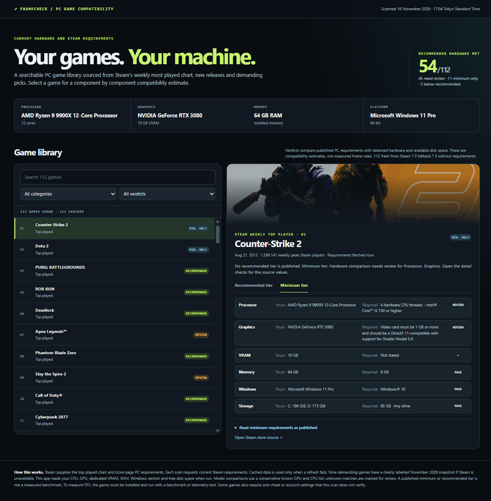
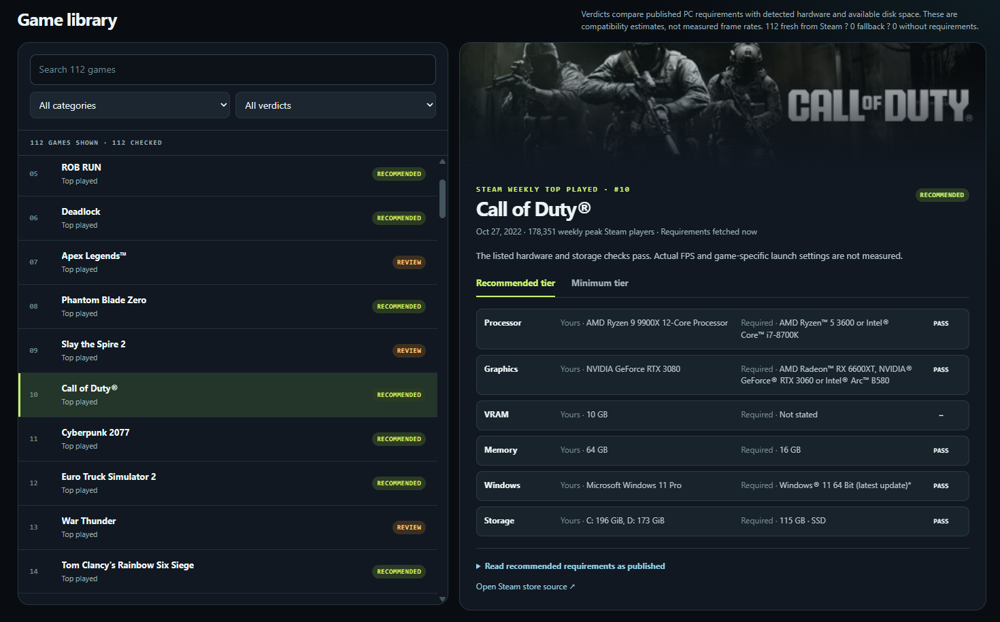
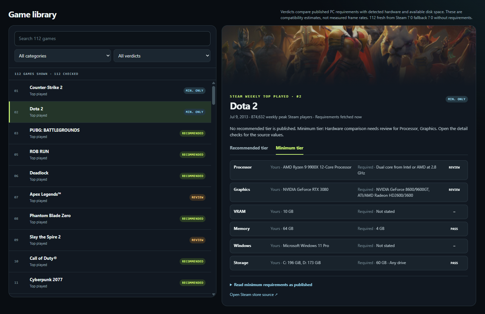

# FrameCheck

FrameCheck scans a Windows PC, checks its hardware against published Steam game requirements, and opens a searchable HTML report.

## Preview

These screenshots show a report generated on one PC on 16 November 2026. Game counts and verdicts change with the machine and the requirements Steam returns.

### Report overview

The report shows the detected CPU, GPU, memory, and Windows version beside a game list. Search by title or filter the list, then select a game to inspect its requirements. Select the image to open it at full size.

[](docs/images/report-overview.png)

<details>
<summary>See a recommended-tier comparison</summary>

Select a game to compare its recommended CPU, GPU, memory, Windows, and storage requirements with the scanned PC. The report shows each check and links to the Steam listing.

[](docs/images/recommended-tier.png)

</details>

<details>
<summary>See a minimum-tier comparison</summary>

Switch to **Minimum tier** to inspect the entry requirements. If Steam publishes no recommended tier, the report says so and shows the available minimum checks.

[](docs/images/minimum-tier.png)

</details>

## Run

On Windows, run `py FrameCheck.py` from a clone. To use the single-file app, build it with `./build.ps1` and open `FrameCheck.exe`. The app starts scanning when it opens, writes `Game Readiness Report.html` beside the source file or executable, and opens the report in your browser. **Scan again** replaces the report with a new scan.

Keep the app window open while using the report. Selecting a game with missing requirements retries its Steam lookup through the local app. Previous results are stored in `%LOCALAPPDATA%\FrameCheck` and used only when Steam cannot return fresh details. The report labels fresh, cached, built-in, and unavailable data.

## Games and verdicts

The list draws from Steam's [weekly most played chart](https://store.steampowered.com/charts/mostplayed), the Store's new releases feed, and nine demanding games. Store listings unavailable in the app's US Store query are excluded. The number of games can change between scans.

FrameCheck compares recognized CPU and GPU models, installed RAM, dedicated VRAM where specified, Windows version, and free disk space. **Review** means a requirement could not be compared reliably. **Minimum only** means Steam did not publish a recommended tier. The report also notes Battlefield 6 security prerequisites that the scan cannot verify.

These are requirement checks, not measured frame rates. Measuring FPS requires running the installed game with its benchmark or a telemetry tool. Steam data and availability can change, and the report links to each game's Store listing for the published requirements.

## Build from source

- `FrameCheck.py` scans Windows hardware, retrieves Steam data, and compares requirements.
- `report_view.py` renders the HTML report and game list.
- `build.ps1` packages the app as one Windows executable.

Building requires Python 3.12 and PyInstaller. From PowerShell in the repository folder:

```powershell
./build.ps1
```

The executable does not require Python on the machine where it runs. An internet connection is needed for fresh Steam data. On NVIDIA systems, FrameCheck reads dedicated VRAM through `nvidia-smi`; if that reading is unavailable, VRAM checks are marked for review. The report loads game header images from Steam and remains readable without them.

## License

The source code is licensed under the [MIT License](LICENSE). Game names, artwork, and requirement text fetched from Steam belong to their respective owners and are outside that license.
